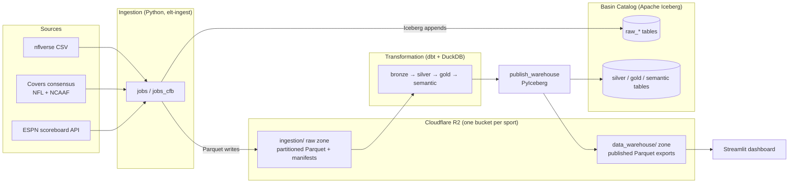
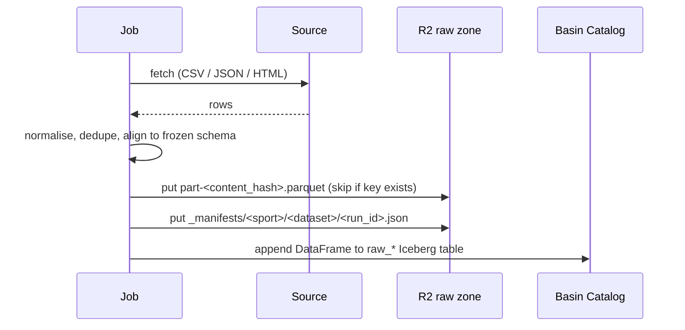
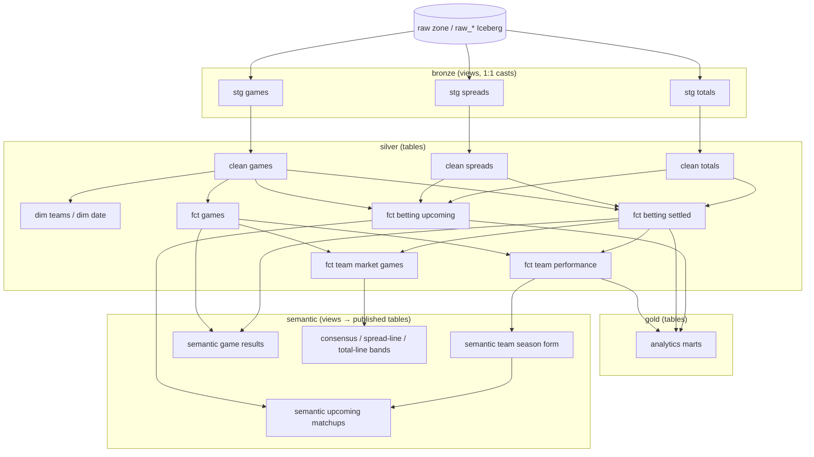
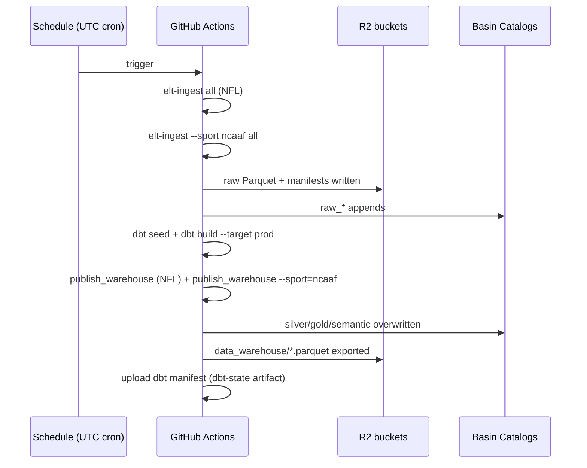

# Architecture

End-to-end architecture of the elt-pipeline: how NFL and NCAAF data moves
from public sources to a BI dashboard, what each component does, and why it
is built the way it is. For a quick start see the [README](../README.md);
this document is the deep reference.

## 1. Overview and design principles

The system is a batch ELT pipeline with two symmetric sport connectors
(NFL, NCAAF) sharing one architecture:



Design principles:

- **ELT, not ETL.** Sources are landed as close to their native shape as
  possible ("raw"), and all shaping happens in the warehouse layer. A
  transformation bug never requires re-scraping; re-running dbt is enough.
- **Idempotency everywhere.** Every write is content-addressed or a full
  overwrite of a derived table. Any job can be re-run at any time and the
  result converges to the same state; there are no "did it already run?"
  questions in operations.
- **State in the storage layer, not a database.** Watermarks and coverage
  are derived from run manifests stored next to the data in R2. The
  pipeline is stateless code over stateful storage.
- **One architecture, two sports.** The NCAAF connector is not a fork: it
  shares the storage, state, Iceberg, dbt patterns, publishing and
  orchestration of the NFL connector. Only the game-results source and the
  team-code mapping differ (see §3.3).
- **Infrastructure as code only.** Every Cloudflare resource is provisioned
  by Terraform. Nothing is created in a console or with Wrangler.
- **Derived data is disposable.** Everything downstream of the raw zone
  can be rebuilt from it. Raw data is the only irreplaceable layer.

## 2. Sources

| Source | Sport | Data | Access |
|---|---|---|---|
| nflverse | NFL | Game schedule/results, 1999–present | Public CSV download |
| ESPN scoreboard API | NCAAF | FBS schedule/results + AP Top-25 ranks | Public JSON API, no key |
| Covers consensus | NFL + NCAAF | Spread/total lines and betting consensus % | Public HTML tables, scraped |

Source selection notes:

- **NFL games come from nflverse, not a scrape.** The previous source
  (Pro Football Reference) is behind a Cloudflare bot challenge that
  rejects both plain HTTP clients and headless browsers; headed-browser
  workarounds were evaluated and rejected as unfit for autonomous
  operation. A maintained CSV dataset is strictly more reliable than a
  scraper for data that does not change shape.
- **NCAAF games come from ESPN, not Covers.** Covers publishes results
  pages, but ESPN's scoreboard API returns structured JSON including
  scores and `curatedRank` (AP Top-25 rank; 99 = unranked), which the
  warehouse needs as first-class columns. Covers is still the source for
  NCAAF market data (lines/consensus), matching the NFL design.
- **Covers remains the market source for both sports** because no free
  structured API publishes consensus percentages. The scrape is a simple
  HTML table read; its fragility is contained because market data is
  re-fetchable and the pipeline tolerates missing dates (see §3.3).

## 3. Ingestion (`data-integration/`)

### 3.1 Shape of the code

The ingestion tier is a Python package, `elt_ingest`, exposed as the
`elt-ingest` CLI. It is deliberately modular so each concern can change
independently:

| Module | Responsibility |
|---|---|
| `config.py` | `Settings` from environment (storage backend, R2, Basin catalog) |
| `nflverse.py` / `cfb.py` | Game-results fetchers (NFL CSV; ESPN JSON incl. ranks) |
| `scrape.py` | Covers consensus scrapers (NFL + NCAAF spreads/totals) |
| `clean.py` | Light normalisation shared by jobs (mapping, dedupe, hashing) |
| `storage.py` | Storage abstraction (local / R2), partitioned writes, `StateStore` |
| `iceberg.py` | Basin Catalog connection, frozen raw schemas, Iceberg appends |
| `jobs.py` / `jobs_cfb.py` | Per-dataset job orchestration (fetch → write → append) |
| `publish_warehouse.py` | Publishes dbt output to Iceberg + Parquet exports (§7) |
| `cli.py` | `elt-ingest [--sport nfl\|ncaaf] {games,spreads,totals,all}` |

### 3.2 Jobs and modes

Each job fetches one dataset (`games`, `spreads`, `totals`) and runs in
one of two modes:

- **Incremental** (default; what the schedule runs): NFL games re-pull the
  current and previous season from nflverse; NCAAF games re-pull the
  current and previous season weeks from ESPN; market jobs fetch only the
  dates that state says are missing, anchored to the last 21 days.
- **Backfill**: full history (NFL from a configurable start year; NCAAF
  full seasons plus every game date lacking a market manifest).

A job's write path for one batch:



### 3.3 Idempotency, state, and dates

- **Content-addressed partitions.** Parquet object keys embed a hash of
  the partition content (excluding `timestamp_imported`):
  `ingestion/raw/<sport>/<dataset>/<partition>/part-<hash>.parquet`.
  Re-fetching identical data produces the same key, which already exists
  and is skipped — a re-run of any job writes zero new objects.
- **Manifest-derived state.** Every write also stores a run manifest
  listing the dates it covered. `StateStore` reconstructs watermarks and
  the set of game dates lacking market data purely from these manifests.
  There is no state database to back up, migrate, or disagree with the
  data: the storage layer *is* the state.
- **Append-only raw, corrected in silver.** Raw rows are never mutated.
  Games first seen as scoreless previews and later with results coexist
  in raw; silver dedupes to one row per game (per ESPN event id for
  NCAAF, per date + team pair for NFL), preferring the scored version.
- **Eastern sports dates (NCAAF).** ESPN kickoff timestamps are UTC, but
  college football's calendar day is the US Eastern date. Using the UTC
  date put evening kickoffs on the following day, which broke the join
  to Covers (whose pages are US-dated) and silently dropped hundreds of
  evening games from market facts. Ingestion therefore converts kickoffs
  to `America/New_York` before deriving `date`/`time`/`day`. This is the
  single most consequential correctness rule in the NCAAF connector.
- **Frozen raw schemas.** The PyArrow schemas in `iceberg.py` are
  contracts. Bronze dbt models cast 1:1 against them, so a source schema
  change fails loudly at the bronze cast instead of drifting downstream.

## 4. Storage: Cloudflare R2

### 4.1 Bucket topology

Terraform (`infra/`) provisions one bucket per sport — `nfl` and `ncaaf` —
each with its own Basin Catalog (§5). A bucket is the unit of blast
radius, credential scoping (the dashboard's read-only token is scoped per
bucket), and lifecycle: NCAAF can be dropped and rebuilt without touching
NFL. Each bucket has two logical zones:

```text
<bucket>/
├── ingestion/
│   ├── raw/<sport>/<dataset>/…        # partitioned Parquet, append-only
│   │     games/season=<year>/part-<hash>.parquet
│   │     spreads/event_date=<date>/part-<hash>.parquet
│   │     totals/event_date=<date>/part-<hash>.parquet
│   └── _manifests/<sport>/<dataset>/<run_id>.json
├── data_warehouse/
│   ├── silver/<table>.parquet         # published dbt output (file form)
│   ├── gold/<table>.parquet
│   └── semantic/<table>.parquet
└── __r2_data_catalog/                 # Iceberg table data, managed by Basin Catalog
```

### 4.2 Why Parquet in R2 as the landing format

- **Columnar and self-describing**: dbt/DuckDB reads the raw zone directly
  with `read_parquet(..., hive_partitioning=true)` — no loader service.
- **Content-addressable bytes**: idempotent writes (§3.3) are trivial when
  the object key is a hash of its content.
- **Cheap and egress-free** within Cloudflare; R2 is also the storage
  substrate Basin Catalog manages, so the raw zone and the Iceberg tables
  live in the same account and addressing scheme.
- Partitioning by `season` (games) and `event_date` (markets) matches the
  natural access pattern (season-scoped builds, date-scoped backfills) and
  keeps individual files small at the current scale (thousands of games,
  not millions).

## 5. Basin Catalog and Apache Iceberg

### 5.1 What Basin Catalog is here

Each bucket has Basin Catalog enabled by Terraform
(`cloudflare_r2_data_catalog`). Basin Catalog is Cloudflare's managed
Apache Iceberg REST catalog: it tracks tables, schemas, snapshots and
data-file metadata, while the actual Iceberg data files live in the same
bucket under the catalog-managed `__r2_data_catalog/` prefix. The catalog
is addressed as:

- URI: `https://catalog.cloudflarestorage.com/<account_id>/<bucket>`
- Warehouse: `<account_id>_<bucket>` (e.g. `…_nfl`, `…_ncaaf`)
- Auth: a Cloudflare API token with Basin Catalog permission, presented
  as a bearer token by PyIceberg / DuckDB

### 5.2 Namespace and table layout

The catalog is organized by *layer*, and raw tables by *sport*:

| Catalog | Namespace | Tables | Writer |
|---|---|---|---|
| `nfl` catalog (bucket `nfl`) | `nfl` | `raw_nfl_games`, `raw_nfl_spreads`, `raw_nfl_totals` | `elt-ingest` appends |
| `ncaaf` catalog (bucket `ncaaf`) | `ncaaf` | `raw_ncaaf_games`, `raw_ncaaf_spreads`, `raw_ncaaf_totals` | `elt-ingest --sport ncaaf` appends |
| per-sport catalog | `silver` | clean staging, dims, facts | `publish_warehouse` overwrite |
| per-sport catalog | `gold` | analytics marts | `publish_warehouse` overwrite |
| per-sport catalog | `semantic` | human-readable serving tables | `publish_warehouse` overwrite |

The NCAAF catalog is a separate warehouse on the `ncaaf` bucket; its
silver/gold/semantic tables keep the same names as NFL's inside their own
catalog (no cross-catalog joins are needed — the dashboard reads buckets,
not catalogs; see §9).

### 5.3 Why Iceberg at all

The raw Parquet zone alone would be enough for DuckDB to read. Iceberg
earns its place for three reasons:

1. **A table contract, not a folder convention.** Schemas are declared
   once (the frozen schemas in `elt_ingest/iceberg.py`), enforced on
   append, and discoverable by any Iceberg-compatible engine (DuckDB,
   Spark, PyIceberg, Basin SQL) without scanning directories.
2. **Snapshots and append semantics.** Raw tables are append-only with
   snapshot history — a bad batch is visible and revertible at the
   catalog level rather than being a pile of files to forensic-sort.
3. **A serving layer for modeled data.** Silver/gold/semantic are
   published as catalog tables (§7), so modeled data has the same
   engine-agnostic contract as raw data. Basin SQL can query these
   tables directly for ad-hoc analysis without any pipeline code.

What Iceberg is *not* used for: it is not the transformation engine, and
Basin SQL is not used to write transformed data (it is a read/query
engine). Transformations are DuckDB's job (§6); writes to catalog tables
are PyIceberg's (§7).

### 5.4 The write-path constraint that shaped the design

DuckDB can attach to an Iceberg REST catalog and read/insert, but it
cannot `CREATE OR REPLACE TABLE` through the catalog — which is exactly
what dbt's table materialization needs. Basin Catalog additionally
rejects table locations outside its managed `__r2_data_catalog/` storage
profile, so Iceberg tables cannot physically live under the
`data_warehouse/` prefix.

Consequence: dbt builds modeled tables inside a DuckDB file, and a
separate publisher (§7) overwrites the catalog tables and exports the
same content as Parquet under `data_warehouse/`. The two-step design is
not ceremony; it is the only path that gives dbt full DDL freedom and
gives consumers stable Iceberg tables.

Raw tables are written differently — direct PyIceberg appends from the
ingestion jobs — because ingestion only ever appends and never needs
DDL beyond the one-time table creation.

## 6. Transformation: dbt on DuckDB

### 6.1 Why dbt + DuckDB

- **dbt** provides the modeling discipline the warehouse needs: declared
  dependencies between models, schema/singular tests as executable
  contracts, sources with freshness checks, and documentation in-repo.
- **DuckDB** is the execution engine because it reads Parquet and
  Iceberg natively over S3, runs embedded in CI and in the Actions
  runner with no server to provision, and handles the current data
  volume (tens of thousands of rows) in seconds. There is no warehouse
  server in this architecture at all — compute is a Python process with
  a `.duckdb` file, in CI and in production alike.

### 6.2 Layer design



(The graph is drawn once; the NCAAF tree is the same shape with
`_ncaaf_` names plus rank columns carried through games → facts →
semantic.)

- **Bronze** (`stg_*`): views that cast raw columns 1:1 to typed
  columns. No joins, no filtering beyond casts. Bronze exists so a raw
  schema break fails in exactly one obvious place.
- **Silver staging** (`clean_*`): all source-specific ugliness is
  resolved here — Covers matchup strings are split into team codes and
  mapped to canonical names (seed tables), winner/loser orientation is
  normalized to home/away, duplicates from the append-only raw zone are
  collapsed preferring scored rows, and unmapped teams are dropped from
  joins rather than guessed.
- **Silver core**: conformed dims (`dim_*_teams`, `dim_*_date`) and
  facts. `fct_*_games` is the game-grain spine; `fct_*_betting_settled`
  joins played games to spread/total markets and computes outcomes
  (cover side, total outcome, whether consensus was right);
  `fct_*_betting_upcoming` is the same join for future fixtures
  (markets may be null until posted); `fct_*_team_market_games` explodes
  settled games to team-game grain with each team's *own* consensus
  share, role (favorite/underdog), consensus band and spread-line
  bucket — this is the fact that makes "when a team is backed by X% of
  bets, how often does it cover?" answerable without double-counting;
  `fct_*_team_performance` carries per-game team results plus running
  aggregates for form views.
- **Gold** (`analytics_*`): pre-aggregated marts (team betting stats,
  rankings, upcoming matchup summaries) for consumers that want
  season-level answers without touching game grain.
- **Semantic** (`semantic_*`): the human surface, and the only layer the
  dashboard conceptual model depends on. Rules: fractions 0–1 rounded to
  two decimals (never percentages), plain column names
  (`against_the_spread_win_pct`, `totals_line_points`), integer W/L/T
  columns next to record strings, market rates computed only over
  *decided* market games (`games_with_market` as the explicit
  denominator; pushes excluded from cover rates), and band tables at
  League and Team scope with season and all-seasons rows (season = 0).

### 6.3 Reading raw: one macro, two backends

Bronze models never hard-code a location. The `raw_table(dataset, sport)`
macro resolves to:

- the partitioned Parquet raw zone
  (`$RAW_BASE_PATH/raw/<sport>/<dataset>/**/*.parquet`) by default — used
  in CI (mock fixtures), local dev, and production builds; or
- the attached Iceberg catalog table (`<catalog>.<sport>.raw_*`) when
  `BASIN_DUCKDB_CATALOG` is set.

The default Parquet path is the production choice for builds: it avoids
a catalog round-trip per model and works identically against the
10-row CI fixtures.

### 6.4 Team mapping

Two different mapping problems, solved two ways:

- **NFL**: nflverse names are canonical. The seed `nfl_team_mappings.csv`
  maps Covers' short codes (`KC`, `LV`, historical aliases like Oakland)
  to the canonical short names. Games never need mapping; only market
  rows do.
- **NCAAF**: ESPN names are canonical (games need no mapping). Covers
  uses its own abbreviations (`BSU`, `TAM`, `CSUS`…), so the seed
  `ncaaf_team_mappings.csv` (~260 rows) maps Covers code → ESPN
  `displayName`. It was built from ESPN's own abbreviation→name pairs in
  the game feed plus verified aliases for Covers-specific codes.
  Unmapped rows (mostly FCS-vs-FCS games absent from the FBS feed) are
  excluded from joins, visibly, rather than fuzzy-matched.

### 6.5 Tests as contracts

- **Schema tests**: uniqueness/not-null on fact keys, relationships from
  facts to dims.
- **Singular SQL tests** encode bug lessons, each named for the incident
  it prevents: unplayed fixtures must not dilute win percentages
  (`team_performance_played_only`, `rankings_win_pct_consistent`),
  upcoming must be future-only — a same-day Super Bowl preview once
  leaked into next season's upcoming
  (`upcoming_games_not_in_past`, `upcoming_covers_all_fixtures`), the
  semantic upcoming display is today-only at build time
  (`semantic_upcoming_today_only`), and join-coverage/grain checks
  (`betting_join_coverage`, `team_market_games_grain`,
  `no_duplicate_games`).
- **CI fixtures**: 10-row samples of the real raw partitions (both
  sports) are committed under `dbt-transform/tests/fixtures/`, so CI
  runs the exact production models without any credentials.

### 6.6 Full refresh, deliberately

Every model is a full-refresh table build. At ~46 models over tens of
thousands of rows a full prod build takes under a minute, and full
refresh makes every rebuild deterministic and backfill-free. The
documented exit condition is explicit: switch to incremental merge on
`game_id` when a full build approaches ~10 minutes.

## 7. Publishing (`publish_warehouse`)

dbt's output lives in `warehouse.duckdb`; nothing downstream reads that
file in production. `elt_ingest.publish_warehouse [--sport=ncaaf]` is
the bridge to serving:

1. For each model in the registry (`MODELS` / `NCAAF_MODELS`), read the
   table from DuckDB.
2. Compare its Arrow schema with the existing Iceberg table; on any
   schema/type change, drop and recreate (the publisher is a full
   overwrite, so recreation is safe and keeps evolution painless).
   All-null columns are cast to string first — Iceberg format v2 rejects
   the `null` type DuckDB/pandas emits for empty columns (this bit the
   NCAAF publish on day one).
3. `table.overwrite(arrow)` into the per-sport catalog under the layer
   namespace (`silver`/`gold`/`semantic`).
4. Export the same frame as Parquet to
   `data_warehouse/<layer>/<table>.parquet` in the sport's bucket — the
   user-visible warehouse zone and the dashboard's read path (§9).

Why overwrite instead of merge: the warehouse is small and fully derived
(§1). Overwrite semantics make publishing idempotent and immune to
partial-failure states; the cost is a rewrite of a few megabytes.

## 8. Orchestration and CI

### 8.1 The autonomous ingest workflow

One GitHub Actions workflow, [`ingest.yml`](../.github/workflows/ingest.yml),
runs the whole pipeline for both sports:



| Trigger (UTC) | Pacific intent | Slate it serves |
|---|---|---|
| `0 15 * * 0` | Sun 07:00 PT | NFL Sunday; also settles Saturday NCAAF |
| `0 21 * * 1` | Mon 13:00 PT | NFL Monday night |
| `0 21 * * 4` | Thu 13:00 PT | NFL Thursday night |
| `0 15 * * 5` | Fri 07:00 PT | NCAAF Friday slate |
| `0 15 * * 6` | Sat 07:00 PT | NCAAF Saturday slate |

GitHub cron is UTC-only and has no timezone or DST support, so Pacific
times are encoded as their UTC equivalents in standard time; during
daylight time (PDT) runs fire one hour later Pacific-local. This is a
documented, accepted drift (a DST-aware scheduler would need a second
system for zero user benefit at these lead times).

Operational properties:

- Both sports ingest on every trigger. Because all writes are
  content-addressed, an off-day run for a sport is a no-op (zero new
  objects), which is also how Saturday's college results get settled by
  Sunday morning without a dedicated trigger.
- A concurrency group (`ingest`, `cancel-in-progress: false`) serializes
  runs so two publishes can never interleave.
- **Transient-failure resilience is layered**, because the failure modes
  observed in production were of two kinds. (a) *Basin Catalog rate
  limits* (HTTP 429 bursts during publish): every catalog write —
  raw appends and publish overwrites — goes through `with_retries`
  (exponential backoff, 4 attempts) in `elt_ingest/iceberg.py`;
  overwrites are idempotent so retrying is always safe. (b) *Any other
  transient step failure* (source hiccups, network): the workflow wraps
  both `elt-ingest` invocations in a shell `retry` (3 attempts) — safe
  because ingestion writes are content-addressed. Non-transient errors
  (schema/type bugs) fail immediately and loudly; retries never mask
  them. A schema-alignment bug of exactly that kind (name-based integer
  casts in the Iceberg append, broken by float scores) is covered by
  `tests/test_iceberg_align.py`.
- The dbt manifest is uploaded as the `dbt-state` artifact on success;
  `ci/dbt` consumes it for its (informational) slim-selection report.
- Manual dispatch supports `incremental` (default) and `backfill`.

### 8.2 Per-module CI

Three independent, path-filtered workflows — a change to one module
never runs another module's CI:

| Workflow | Paths | Gate |
|---|---|---|
| `ci/data-integration` | `data-integration/**` | pytest, byte-compile, CLI smoke |
| `ci/dbt` | `dbt-transform/**` | Full dbt build + data tests against committed 10-row mock raw fixtures (both sports), no credentials |
| `ci/infra` | `infra/**` | `terraform fmt`/`validate`; deploys via `github/branch-deploy` IssueOps (`.deploy` on a PR) |

The dbt CI history is instructive: it originally built only
`state:modified+` (slim CI), but on an ephemeral CI DuckDB the slim
selection repeatedly false-failed when singular tests referenced models
outside the selection. Since the full fixture build takes under two
minutes, CI builds everything; slim selection is still computed against
the production manifest and printed for information.

### 8.3 Infrastructure management

Terraform in `infra/` is the only provisioning path (R2 buckets, Basin
Catalogs). Applies go through the branch-deploy flow against the
production environment. State is remote: an S3 backend on R2 itself
(bucket `elt-tfstate`, key `elt-pipeline/infra/terraform.tfstate`,
native lockfile enabled; settings in `infra/backend.hcl`, credentials
from the R2 keys). The state bucket is the one resource Terraform
cannot create with remote state already in place, so it is provisioned
by the tiny `infra/bootstrap/` module, applied once by hand with its
own local state. The repo variable `TF_STATE_BACKEND_CONFIG=backend.hcl`
points the deploy job at the backend config; the job still refuses to
run if that variable disappears, rather than apply against an ephemeral
runner-local state.

### 8.4 Secrets

All runtime configuration is environment variables with identical names
locally (`.env`, never committed) and in GitHub Actions secrets:

- R2 S3 credentials (`R2_ACCOUNT_ID`, `R2_ACCESS_KEY_ID`,
  `R2_SECRET_ACCESS_KEY`, `R2_S3_HOST`) — ingestion writes; derived from
  an R2 API token.
- Basin Catalog (`BASIN_CATALOG_URI`, `BASIN_WAREHOUSE`, `BASIN_TOKEN`)
  — NFL catalog; NCAAF values are derived by suffix substitution, with
  optional `NCAAF_BASIN_*` overrides.
- `CLOUDFLARE_API_TOKEN` — Terraform only.

## 9. BI layer: Streamlit dashboard

### 9.1 What it is

A private, password-gated Streamlit app (`dashboard/`) presenting the
semantic layer for human decision support — trends, form, and market
context, with no bet recommendations (a deliberate product constraint:
the app informs the user's own decisions). A sidebar sport switcher
gives NFL and NCAAF identical sections (Today, Team Form, Trends,
Consensus) over their own buckets.

### 9.2 Data path, and why it is Parquet — not Iceberg

The dashboard reads the `data_warehouse/semantic/*.parquet` exports (and
selected silver tables) from R2 with DuckDB over HTTPS, using a
bucket-scoped **read-only** R2 token stored in Streamlit secrets. It
does not query the Basin Catalog.

That is a considered choice, not a shortcut: Streamlit Community Cloud's
free tier runs a small container where attaching a REST Iceberg catalog
(PyIceberg/DuckDB-iceberg + token refresh) is heavier and more brittle
than reading a handful of Parquet files, and the serving tables are
exactly as fresh as the Iceberg ones (published in the same step, §7).
The Iceberg tables remain the contract for engine-based consumers
(Basin SQL, Spark, notebooks); the Parquet zone is the file contract
for the app. Both are published atomically enough for a batch pipeline
that updates a few times a week, and app data is cached for an hour.

Deployment: the app is exported to a standalone public repo
(`dashboard/export_standalone.sh`) because the main repo is private and
Streamlit's OAuth grant cannot be scoped to it; the app itself is
protected by a shared password, and the standalone repo contains no
secrets (real keys live only in Streamlit's secret store).

### 9.3 Read-time semantics (two bugs that set the rules)

- **"Today" is computed when the page loads, not when the warehouse was
  built.** The semantic upcoming table is filtered to its build day, so
  the Today page reads the silver `fct_*_betting_upcoming` fixtures,
  joins form at read time, and filters to the current Pacific date —
  falling back to the next slate under its real date. A build-day game
  can therefore never be displayed as "today's" game on a later day.
- **Historical view is a first-class mode**: the same matchup card
  renders any played game (season → date → game pickers) from semantic
  results + settled market context, defaulting back to today/next slate
  on entry.

## 10. Technology choices

| Concern | Choice | Why |
|---|---|---|
| Object storage | Cloudflare R2 | S3-compatible, zero egress in-account, hosts both the raw zone and Iceberg data |
| Table format | Apache Iceberg via Basin Catalog | Engine-agnostic table contracts, snapshots, managed metadata without running a catalog service |
| Ingestion | Python (`elt-ingest`) | One language across fetch/transform glue; PyIceberg + pandas/Arrow are native here |
| Transformation | dbt (SQL) | Declared model graph, tests as contracts, sources/freshness built in |
| Query/build engine | DuckDB | Embedded, reads Parquet/Iceberg over S3, no warehouse server to run or pay for |
| Catalog writes (modeled) | PyIceberg overwrite | Works around DuckDB's `CREATE OR REPLACE` catalog limitation (§5.4) |
| Infrastructure | Terraform | Only provisioning path; reviewable, repeatable, branch-deploy gated |
| Orchestration | GitHub Actions cron | Zero extra infra; secrets, artifacts and path-filtered CI in one place |
| BI | Streamlit | Python-native (same skill/tooling as the pipeline), free-tier hosting, fast to iterate |

Rejected or retired alternatives, for the record:

- **MotherDuck / local files** (legacy pipeline): a hosted DuckDB was
  the original target; it added an account and credentials to operate
  what DuckDB-over-R2 already covers, and local-disk state made
  autonomous runs impossible. Removed entirely at cutover.
- **Pro Football Reference scraping** for NFL games: bot-challenged
  (403 for all automated clients); replaced by nflverse (§2).
- **Headed-browser scraping** around bot challenges: rejected — a
  pipeline that needs a human to solve challenges is not autonomous.
- **MetricFlow (dbt Semantic Layer)** for metrics: requires dbt Cloud
  for the managed service; the semantic layer is instead plain dbt
  models published as tables, which the dashboard reads directly.
- **Basin Pipelines / Basin SQL as the transform path**: Pipelines
  targets event streaming into Iceberg, and Basin SQL is read/query
  only — neither replaces batch dbt modeling (§5.3).

## 11. One game, end to end

A Saturday NCAAF game illustrates the whole system:

1. **Fri 07:00 PT** the workflow fires. `elt-ingest --sport ncaaf all`
   re-pulls ESPN weeks, derives Eastern dates/ranks, writes new/changed
   Parquet partitions + manifests to `s3://ncaaf/ingestion/`, and
   appends to `raw_ncaaf_games`. Market jobs fetch the Covers
   consensus pages for any uncovered game dates into
   `raw_ncaaf_spreads`/`raw_ncaaf_totals`.
2. **dbt build** casts raw to bronze, maps Covers codes to ESPN names,
   dedupes previews, joins the game to its spread/total in
   `fct_ncaaf_betting_upcoming`, and refreshes form/bands.
3. **publish_warehouse --sport=ncaaf** overwrites the catalog tables and
   exports Parquet. The dashboard's Saturday slate now shows the game
   with lines, consensus, AP ranks and band history.
4. **After the game**, Sunday's run lands the final score (same event
   id; silver prefers the scored row). The game moves to
   `fct_ncaaf_betting_settled` with its cover/total outcomes, feeding
   team form and the consensus/line band tables — and becomes available
   in the dashboard's historical view.

Failure recovery at every step is the same verb: re-run. Content
hashing makes re-ingestion a no-op for unchanged data, and full-refresh
models plus overwrite publishing make re-transformation converge.

## 12. Known limitations and future work

- **Bootstrap state is local**: the `elt-tfstate` bucket's own
  single-resource state lives in `infra/bootstrap/` (gitignored); the
  main configuration's state is remote (§8.3). Local copies of the
  pre-migration state are not used by Terraform anymore.
- **GitHub cron has no DST awareness**; Pacific run times drift one
  hour during PDT (§8.1).
- **Covers is a scrape**: layout changes will fail market jobs loudly
  (bronze casts / missing-date retries) but require a scraper fix;
  games data is unaffected. Some Covers dates return no table at all
  and remain "missing" until Covers serves them.
- **NCAAF history starts at 2025** (ESPN feed window), and FCS-vs-FCS
  market rows cannot join the FBS game feed (§6.4).
- **ESPN's API is unofficial**; a shape change fails the NCAAF games
  job, not the NFL pipeline (jobs are independent and each run's
  failure is visible in the workflow).
- **Full-refresh dbt** and overwrite publishing are sized for today's
  volume; §6.6 names the trigger to revisit them.
- The dashboard uses a shared password (not per-user auth), appropriate
  for a private single-user tool on the free tier.
